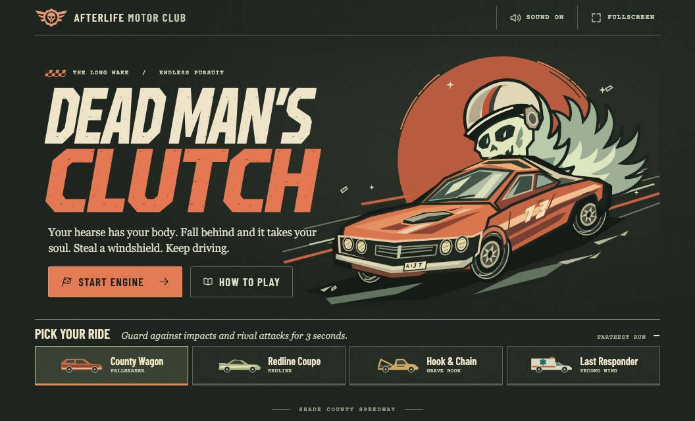

# Dead Man’s Clutch

**Your hearse has your body. Fall behind and it takes your soul.**

*The Long Wake* is an endless, single-player dirt-track pursuit for the **Bounce Back!** game jam. Pick a starter, chase traffic through the floodlights, and steal the next car while the old one is still rolling. The club records how far you get and how many clean jumps you can link.



## Play

Download **play-dead-mans-clutch.html** from the [latest release](https://github.com/EvanProgramming/dead-mans-clutch/releases/latest) and open it in a browser. Everything runs offline. Audio starts on the first input. Your car selection, mute setting, distance record, and longest jump chain are stored locally when the browser allows it.

| Action | Input |
| --- | --- |
| Accelerate / brake | W / S or ↑ / ↓ |
| Steer | A / D or ← / → |
| Use the current car’s ability | E or the ability button |
| Charge a draft jump | Hold gas in the marked wake behind moving traffic |
| Spend the charge | Hold Space to aim, release to jump. Alternatively, tap **Steal a ride**, then a marked car or **Jump** |
| Aim during a crash or draft jump | Point at a windshield or use A / D or ← / → |
| Keep your body, or call a tow if totaled | X or the **Stay / Tow** button |
| Pause / restart current pack / mute | Esc / R / M |

Touch controls support simultaneous steering and throttle. The oval guides the heading through each bend. You choose the racing line, the moment to bail out, and the body you want next.

## The pursuit

The hearse carries your body. Give it too much road and your soul starts draining. Get back ahead and you recover. The opening has a short grace period. The orange soul meter and downward arrow signal a drain. Zero soul ends the run.

The **hearse** rings a toll bell down a marked strip of track. The **Hound** stalks from behind, then commits to a ram. A striped lane and a distinct sound warn you before either strike. Steer out, jump, or time the wagon’s guard. A hit damages the current chassis and costs speed. Each lap raises the pressure. When you open a large lead the hearse accelerates to chase you down.

| Ride | Ability | When it helps |
| --- | --- | --- |
| County Wagon | **Pallbearer** | Guard for three seconds. Hold your line through a warning or a crowded bend. |
| Redline Coupe | **Redline** | Get an immediate kick and 2.8 seconds of overdrive. Make up a gap on clear dirt. |
| Hook & Chain | **Grave Hook** | Pull speed from a car ahead. The hook favors a rival in reach and slows it while you accelerate. |
| Last Responder | **Second Wind** | At 55 mph or faster, mend 32 chassis damage and recover up to eight soul. |

The starter vehicles are worn. A fresh host can have a stronger engine as well as a different ability. Each chassis type has its own cooldown, which follows you between cars. Target flags show each car’s move. The selection panel shows its top speed and how many car lengths the jump would gain or lose.

Hard impacts open an escape window. You can also earn a jump by following a moving car’s wake. A full charge stays banked. Try holding it for a tow truck with a shot at the hearse, or spend it now to jump through a pack. A clean draft landing grants overdrive. Land another draft jump within nine driving seconds to extend the chain and increase the burst. A hard hit breaks the chain.

**Retry this pack** restarts the same field. **Change car & pack** returns to the garage and deals different traffic on the next start. The **Your best** stripe marks your previous distance on the actual road.

## Design note

A crash gives you two decisions. Where will the abandoned car go, and which windshield gets you out? A wagon can roll through the hay gate at Turn Two, opening the inside line to everyone. A wreck can also cost the hearse speed. Wrecks normally survive your next lap, then the game recycles them out of sight to keep a field of living hosts.

The endless edition grew out of a problem with the original three-lap race. In a browser playtest, holding gas after taking the first coupe produced more than a minute and a half without another windshield prompt. Drafting now lets the driver start a transfer. The Hound, the soul drain, and body-specific abilities give a reason to do it again. The target badges make the choice legible while the pack is moving.

## Build and verify

Serve the source from the repository root, then open the [local game](http://127.0.0.1:8000).

```sh
python3 -m http.server 8000 --bind 127.0.0.1
```

Build the release with Python 3.8+ and run the regression tests with Node 20+.

```sh
python3 tools/build.py
node --test tests/*.test.mjs
```

The build writes `dist/dead-mans-clutch-itch.zip` and `dist/play-dead-mans-clutch.html`. The zip contains `index.html` at the root, plus license text. A local font, authored vector art, Canvas renderer, fixed-step simulation and Web Audio score are embedded in the HTML. It needs no package install, network service or special hosting headers.

The tests cover vehicle contact through crowded bends, ordered lap gates, soul drain and recovery, rival strike timing, dodges, guards, all four powers, jump cancellation, chain expiry, seed replay, bounded vehicle count and survival beyond lap four.

In an automated Chromium playtest of the published zip, the driver passed the former finish line and entered lap four at 7.36 km with 80% soul. The run used all four chassis abilities, took hits from both rivals, and linked five clean jumps. A stationary run depleted its soul in 22.3 seconds. A skilled run initially put the hearse a full lap behind, which prompted the physical catch-up behavior. The downloadable game was also exercised inside a nested iframe with keyboard, pointer and emulated touch input, including holding the gas with one finger while using a power or choosing a windshield with another.

## Suggested itch.io listing

**Title** — Dead Man’s Clutch: The Long Wake

**Short description** — An endless ghost-car pursuit. Jump windshields, steal four different powers, and stay ahead of the hearse carrying your body.

**Page copy** — Shade County doesn’t have a finish line anymore. The hearse wants your soul and the Hound is coming up on your bumper. Steal an ambulance for one more mile, snatch the hearse’s speed with a tow hook, or send a wreck through the hay bales and jump clear. How far past your own grave marker can you drive?

**Controls** — WASD or arrows to drive. E uses your car’s power. Follow traffic to charge a jump. Hold Space, aim with the mouse or arrows, then release to steal a windshield. Hard crashes also open a jump. X stays, Esc pauses, R retries, and M mutes.

**Upload settings** — Select HTML, upload the zip, enable browser play, and use a 960 × 540 embed with fullscreen available. The game also adapts to portrait. [itch.io HTML5 guide](https://itch.io/docs/creators/html5)

**Screenshot moments**

- [Choose a starter](press/starting-grid.jpg) — the four-car garage beneath the speedway poster.
- [Jump windshields](press/windshield-jump.jpg) — a ghost in flight between moving cars.
- [The Hound’s attack](press/the-hunt.jpg) — the marked lane before a rival strike.
- [Relay through traffic](press/relay.jpg) — a live chain in the middle of a run.

## Credits and license

Game design, simulation, hand-authored vector cover and lettering, Canvas vehicles and track, interface, music, and effects were created for this project with Codex. The illustrations are drawn from authored geometry. The music and engine notes are synthesized with oscillators, filtered noise and envelopes. Original material is under the [MIT License](LICENSE).

Barlow Condensed SemiBold is by Jeremy Tribby and the Barlow Project Authors, used under the [SIL Open Font License 1.1](assets/OFL-Barlow.txt). The unmodified typeface is bundled locally. [Font source](https://github.com/google/fonts/tree/main/ofl/barlowcondensed)
