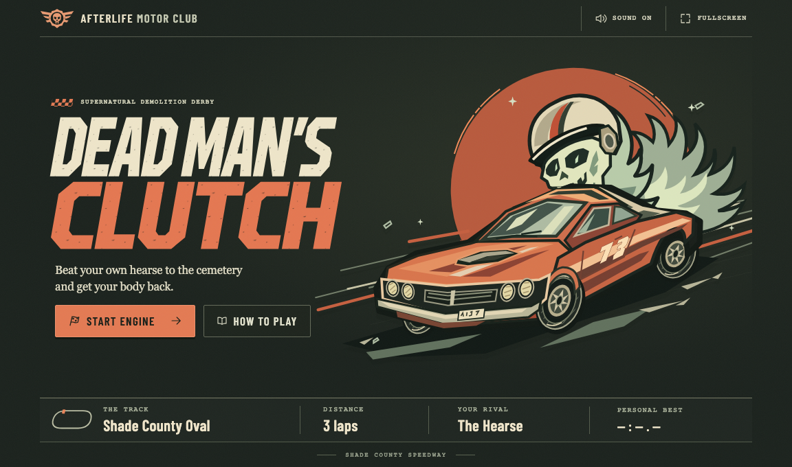

# Dead Man’s Clutch

**Beat your own hearse to the cemetery and you get your body back.**

A single-player browser racer made for the **Bounce Back!** game-jam theme. Drive three laps of Shade County Oval. Hit a wreck hard and time slows long enough to steal a nearby vehicle. Your old car keeps rolling. It can punch through the hay gate at Turn Two, shove another wreck, or block the hearse on the next lap.



## Controls

| Action | Input |
| --- | --- |
| Accelerate / brake | W / S or ↑ / ↓ |
| Steer left / right | A / D or ← / → |
| Pick a windshield during slow motion | Aim the pointer at a marked car, or press ← / → |
| Jump into the highlighted car | Release the mouse over its windshield, release Space, or press **Jump** |
| Keep the current car, or call a tow if totaled | X or the **Stay / Tow** button |
| Pause / resume | Esc or the pause button |
| Restart immediately | R |
| Mute / unmute | M or the speaker button |

On a touch display, hold the on-screen gas, brake, and steering buttons. Tap a highlighted car to possess it. The oval guides your car through each bend, leaving you in control of its racing line. The green map dot is you. The red diamond is the hearse.

## Play and build

Download **play-dead-mans-clutch.html** from the [release](https://github.com/EvanProgramming/dead-mans-clutch/releases/latest) and open it in a browser. The standalone edition works offline. Audio starts after a gesture. Best winning time and mute preference are saved in your browser when local storage is available.

To play from source, run this in the repository root and open [the local game](http://127.0.0.1:8000).

```sh
python3 -m http.server 8000 --bind 127.0.0.1
```

Build with Python 3.8+ and run the simulation checks with Node 20+.

```sh
python3 tools/build.py
node --test tests/sim.test.mjs
```

The build writes `dist/dead-mans-clutch-itch.zip` and `dist/play-dead-mans-clutch.html`. The zip contains the standalone build as its root `index.html` and a license file. The build embeds the original art, font, sound synthesis and game code. It needs no package install, CDN, server API, special response headers, or shared memory.

## Design note

The comeback is the player's biggest move. At speed, a wagon can break a barricade that a coupe would rather drive around. A well-placed impact gives you two things to aim: the wreck you're leaving behind and the windshield where you want to land. The hearse can take any shortcut you open.

The three cars reward different lines. The coupe accelerates and changes lanes fastest. The wagon is steady under contact. The tow truck takes less damage and transfers more momentum into a pileup. One track, one rival and persistent wrecks keep each decision visible across three laps. A short engine cut, bent sheet metal, and an arcing ghost make the handoff readable at a glance.

## Release playtest

The packaged game was extracted and served under a nested path inside a local iframe. Chromium drove a three-lap win in 2:09.3, lost to the hearse on a separate run, and continued after a totaled-car tow. Both keyboard targeting and a mouse click on the moving windshield were exercised. The browser recorded zero console errors and requested only the local frame and game document. A separate 960 × 540 real-time sample through the opening pileup recorded a 16.7 ms median and 95th-percentile frame interval. The Web Audio output was active after starting and silent when muted. Fourteen simulation checks cover race outcomes, possession, collision mass, persistent wrecks, the shortcut and same-frame finishes.

The first corner was tuned so two cars remain reachable and the abandoned wagon can carry its momentum into the hay gate. The gap display and live track map were added after a race where the lead was hard to read. With more time, the next priority would be playtests with first-time drivers to tune the five-second clutch window and the challenge of the final lap.

## Suggested itch.io listing

**Title** — Dead Man’s Clutch

**Short description** — Crash your muscle car. Steal the next windshield. Beat your own hearse around a haunted dirt oval and win your body back.

**Page copy** — Welcome to Shade County Speedway. The hearse has your body, the pit crew has stopped asking questions, and you have three laps to catch it. Send a wagon through the hay bales at Turn Two and jump into a passing coupe. Remember where you left that wreck. You'll be back.

**Controls** — WASD or arrows to drive. On impact, aim and click a windshield or select it with the arrows and release Space. X stays in the car. Esc pauses, R restarts, M mutes.

**Upload settings** — Select HTML, upload the itch zip, and enable browser play. Use a 960 × 540 embed with the fullscreen button. The game adapts to other window sizes. [itch.io HTML5 guide](https://itch.io/docs/creators/html5)

**Screenshot moments**

- [Starting grid](press/starting-grid.png) — the illustrated cover and county speedway race card.
- [Windshield jump](press/windshield-jump.png) — the ghost between the battered wagon and its next ride.
- [Turn Two](press/turn-two.png) — lap two with the shortcut broken open.
- [The cemetery finish](press/cemetery-finish.png) — the coupe and hearse on their last approach to the stripe.

## Credits and license

Game design, simulation, Canvas track art, car sprites, SVG cover, title lettering, interface, and synthesized music and sound effects were created for this project with Codex. The illustrations are authored vector geometry. The soundtrack is generated with Web Audio oscillators, filtered noise and envelopes. All original material is under the [MIT License](LICENSE).

Barlow Condensed SemiBold is by Jeremy Tribby and the Barlow Project Authors, used under the [SIL Open Font License 1.1](assets/OFL-Barlow.txt). The unmodified typeface is bundled locally. [Font source](https://github.com/google/fonts/tree/main/ofl/barlowcondensed)
